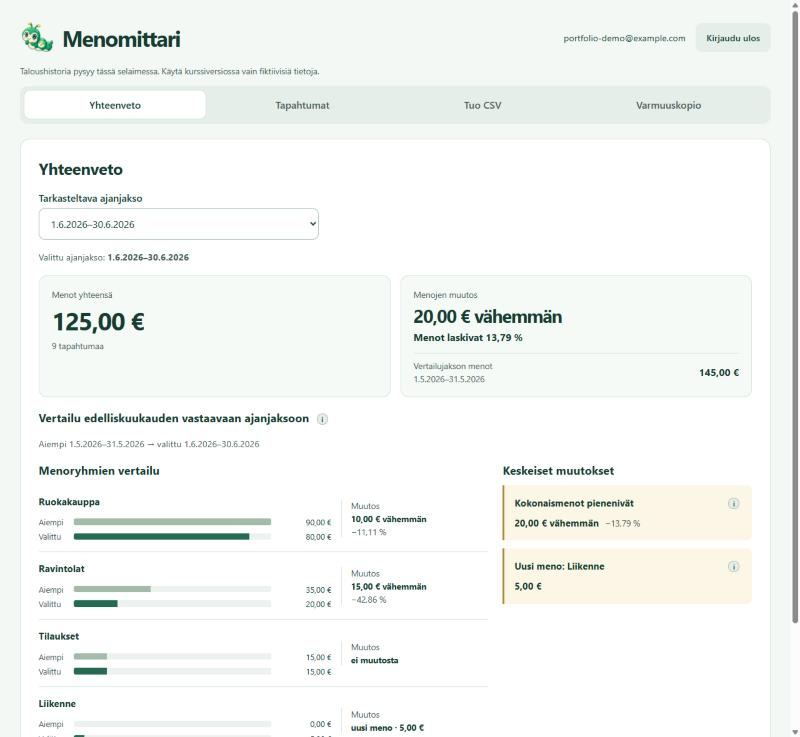

# Menomittari

*A local-first spending tracker: import bank transactions as CSV, group your spending and compare two periods. Financial data never leaves the browser. Built with React, TypeScript, FastAPI and IndexedDB, together with a coding agent (human in the loop). Documentation is in Finnish.*



Menomittari on full stack -sovellus: käyttäjä tuo tilitapahtumat CSV-tiedostona, tarkastelee menoja ja vertaa kahta ajanjaksoa. React/TypeScript-käyttöliittymä käsittelee taloushistorian paikallisesti IndexedDB:ssä. FastAPI-backend tallentaa vain käyttäjätilit ja kirjautumisistunnot SQLiteen.

## Miten projekti tehtiin

Menomittari on oma ideani, ja toteutin sen Web-ohjelmoinnin kurssin lopputyönä elo–lokakuussa 2026. Koodin kirjoitti koodausagentti, mutta päätökset tein minä. Ihminen oli mukana jokaisessa vaiheessa (*human in the loop*):

- **Minä:** tuotetavoite ja MVP:n rajaus, arkkitehtuuri- ja teknologiavalinnat agentin kanssa keskustellen, agentin työohje ([AGENTS.md](AGENTS.md)) sekä jokaisen vaiheen testaus selaimessa ja hyväksyntä.
- **Agentti:** koodi, automaattiset testit ja jokaisen vaiheen työseloste suunnitelmien pohjalta.
- **Työtapa:** jokainen vaihe tehtiin omalla haarallaan. Agentti ei saanut yhdistää muutoksia päähaaraan, vaan tarkistin ja yhdistin ne itse.

Työselosteet (`docs/p0-XX-oppituntimateriaali.md`) ovat agentin kirjoittamia selityksiä jokaisen vaiheen valinnoista ja toteutuksesta. Kävin ne läpi, jotta ymmärrän ja voin perustella ratkaisut.

## Rajaukset

Kurssiversio on prototyyppi, ei tuotantopalvelu. Se ei vielä tunnista toistuvia maksuja, näytä koko vuoden yleiskuvaa tai synkronoi tietoja laitteiden välillä. Kaikki rajaukset ovat [projektisuunnitelmassa](docs/project-plan.md#mvpn-rajaukset).

## Käynnistäminen

Tarvitset Dockerin (Compose v2) ja selaimen. Node.js:ää tai Pythonia ei tarvitse asentaa, koska kaikki ajetaan konteissa.

```bash
git clone https://github.com/tuuturulla/menomittari-spending-tracker.git
cd menomittari-spending-tracker
docker compose build
docker compose run --rm backend uv run --no-sync alembic upgrade head
docker compose up
```

Avaa sovellus osoitteessa <http://127.0.0.1:5173> ja luo itsellesi käyttäjätili. API-kuvaus on osoitteessa <http://127.0.0.1:8000/docs>.

- Käytä osoitetta `127.0.0.1`, ei `localhost`: kirjautuminen ja selaimen tallennus riippuvat osoitteesta.
- Porttien 5173 ja 8000 pitää olla vapaina.
- Pysäytä sovellus `Ctrl+C`:llä ja poista kontit komennolla `docker compose down`.

## Kokeile demoaineistolla

Esimerkkitiedostot ovat kansiossa [frontend/tests/fixtures](frontend/tests/fixtures). Aineisto on keksittyä.

1. Avaa **Tuo CSV** ja tuo huhti-, touko- ja kesäkuun tiedostot kokonaisina kuukausina.
2. Tuo heinäkuun tiedosto omana ajanjaksona 1.–15.7.
3. Avaa **Yhteenveto**: näet menot ryhmittäin ja vertailun edelliseen kuukauteen.
4. **Tapahtumat** näyttää yksittäiset rivit.

Sovellus tukee Menomittarin omaa demomuotoa ja S-Pankin CSV-vientiä. Odotetut luvut ovat [aineistosopimuksessa](docs/data-contract.md#demojen-odotusarvot).

## Varmuuskopio

Talousdata säilyy vain siinä selaimessa, jossa sovellusta käytetään. Jos selaimen tiedot tyhjennetään, data katoaa. Siksi sovelluksessa on **Varmuuskopio**-osio, josta historian voi ladata JSON-tiedostona ja palauttaa myöhemmin.

- **Kopio on salaamaton**, joten tiedoston saaja voi lukea tapahtumat.
- Palautus onnistuu vain tyhjään sovellukseen, eikä se korvaa olemassa olevaa historiaa.

## Testit

Kaikki tarkistukset ajetaan yhdellä komennolla Bashissa (Windowsissa esim. Git Bash), kun Docker on käynnissä:

```bash
bash scripts/check.sh
```

Skripti ajaa frontendin testit (Vitest), tyyppitarkistuksen, lintin ja koosteen sekä backendin migraatiot ja testit (pytest). Se on testattu Windowsissa.

## Dokumentaatio

| Dokumentti | Sisältö |
| --- | --- |
| [Projektisuunnitelma](docs/project-plan.md) | Tavoite ja MVP:n rajaukset |
| [Arkkitehtuuri](docs/architecture.md) | Sovelluksen osat ja tiedon kulku |
| [Aineisto ja laskenta](docs/data-contract.md) | CSV-muodot ja laskentasäännöt |
| [Rajapinnat](docs/api.md) | HTTP-rajapinta |
| [Työlista](docs/backlog.md) | Vaiheet P0-01–P0-09 ja niiden hyväksymisehdot |
| [Käyttötesti](docs/p0-08-kayttotesti.md) | Selaimessa tehdyt tarkistukset |

Jokaisesta vaiheesta on lisäksi työseloste: [P0-01](docs/p0-01-oppituntimateriaali.md), [P0-02](docs/p0-02-oppituntimateriaali.md), [P0-03](docs/p0-03-oppituntimateriaali.md), [P0-04](docs/p0-04-oppituntimateriaali.md), [P0-05](docs/p0-05-oppituntimateriaali.md), [P0-06](docs/p0-06-oppituntimateriaali.md), [P0-07](docs/p0-07-oppituntimateriaali.md), [P0-08](docs/p0-08-oppituntimateriaali.md) ja [P0-09](docs/p0-09-oppituntimateriaali.md).
