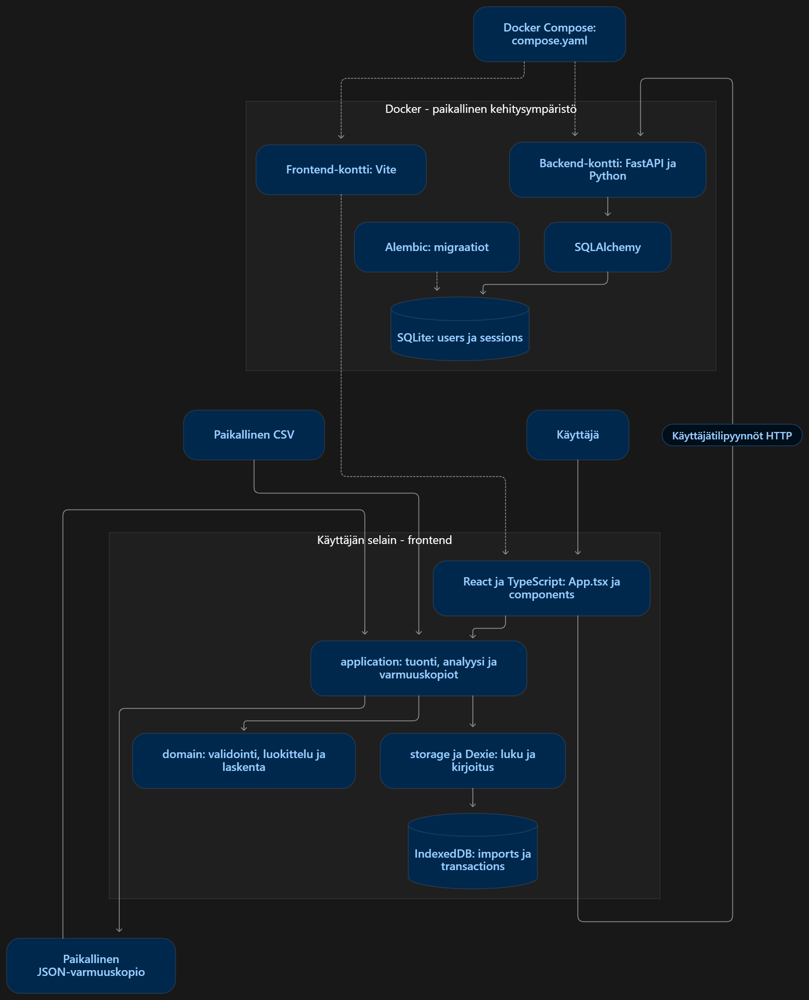

# Arkkitehtuuri

Tekninen kuvaus toteuttajille. Tuotteen tavoite ja [MVP:n rajaukset](project-plan.md#mvpn-rajaukset) ovat projektisuunnitelmassa, tiedot ja laskenta [aineistosopimuksessa](data-contract.md) ja toimintojen sopimus [api.md:ssä](api.md).

## Osat ja tiedonkulku



Frontend ja talouslaskenta suoritetaan selaimessa. Taloushistoria tallennetaan IndexedDB:hen, eikä sitä lähetetä backendille. FastAPI käsittelee käyttäjätilit ja istunnot, jotka tallennetaan SQLiteen. Tietokantojen välillä ei ole synkronointia.

Kaavion Vite-palvelin koskee kehitysympäristöä. Tuotantojulkaisussa Vite kokoaa `frontend/dist`-tiedostot, jotka web-palvelin tai hosting-palvelu toimittaa selaimelle; Viten kehityspalvelinta ei tarvita.

### Koodin sijainnit

```text
frontend/src/App.tsx       Käyttäjätilit ja paikalliset toiminnot yhdistävä React-näkymä
frontend/src/components/  Tuonti, varmuuskopio, tapahtumanäkymä ja vertailun esitys
frontend/src/application/  tuonti, analyysin kokoaminen ja varmuuskopiot
frontend/src/domain/       kenttävalidointi, luokittelu ja laskenta
frontend/src/storage/      Dexie, tietomalli ja tietokantakyselyt
frontend/tests/fixtures/   fiktiiviset testi- ja esittelyaineistot
backend/app/api/           käyttäjätilien HTTP-reitit
backend/app/services/      tunnistautuminen ja istuntojen käsittely
backend/app/db/            SQLAlchemy-mallit ja tietokantayhteys
backend/migrations/        Alembic-migraatiot
```

Application käyttää muutamaa tallennusfunktiota, jotka palauttavat tavallisia TypeScript-tietoja. Dexie-oliot eivät leviä muihin osiin. Domain saa aineiston parametreina eikä käytä tietokantaa, Reactia tai selain-API:a. UI muotoilee luvut, mutta ei laske toista versiota yhteenvedosta.

CSV luetaan Papa Parsella merkkijonoiksi, tarkistetaan ja luokitellaan ennen tallennusta. Yksi tallennusoperaatio tarkistaa päällekkäisyyden ja lisää koko aineiston. Analyysi lasketaan yhteisestä lukutransaktiosta saadusta aineistosta. Taloustietoja ei lähetetä palvelimelle eikä niille tehdä toista pysyvää analyysikantaa.

Varmuuskopion vienti käyttää samaa yhteistä lukutransaktiota. `application/backup-format.ts` tarkistaa JSON-rakenteen ja käyttää storagen yhteisiä tietue-ehtoja. `restoreEmptyHistory` tarkistaa molempien taulujen tyhjyyden kirjoitustransaktion sisällä ja lisää alkuperäiset tietueet; se ei tyhjennä, yhdistä tai korvaa historiaa. `BackupPanel` käynnistää paikallisen Blob-latauksen tai palautuksen ja näyttää tuloksen painikkeiden vieressä. Palautus ei muuta skeemaa eikä backendia.

Tuontijakso ja analyysin vertailuväli ovat eri asioita: edelliskuukauden tuonnista voidaan laskea vain vastaavat päivät. Vertailuväli ja vertailutapa kuuluvat laskennan tulokseen, eivät IndexedDB:n skeemaan. Kuukausivalinta ja tämä päiväsuodatus eivät muuta tallennettuja tuonteja tai tapahtumatunnisteita.

Osionavigointi on Appin paikallista React-tilaa, ei uusi backend-reitti. Yksi TransactionHistory pysyy liitettynä näkymään osioiden vaihtuessa, jotta valittu jakso ja tapahtumasivu säilyvät. Piilotetut lomakkeet eivät ole näkyvissä tai näppäimistön kohdistusjärjestyksessä. CategoryComparison skaalaa jo lasketut summat yhteiseksi pylväsesitykseksi ja näyttää muutoksen omassa sarakkeessaan; se ei laske uutta analyysiä. InfoHint tekee palautusten selityksen saataville myös ilman hiirtä. Brändikuva toimitetaan paikallisesti Viten kokoamana resurssina.

## Backendin vastuu ja tietoraja

FastAPI-backend vastaa käyttäjän rekisteröinnistä, kirjautumisesta, kirjautumistilan tarkistamisesta ja uloskirjautumisesta. SQLAlchemy käyttää MVP:ssä SQLitea, ja Alembic hallitsee tietokannan rakenteen muutokset. Python-riippuvuudet lukitaan ja suoritetaan `uv`:lla backendin Docker-kontissa.

Backendin tietokannassa on kaksi taulua:

| Taulu | Kentät |
| --- | --- |
| users | id: UUID, email_normalized: yksilöllinen merkkijono, password_hash, created_at: UTC-aikaleima |
| sessions | token_hash: yksilöllinen merkkijono, user_id: viite käyttäjään, created_at ja expires_at: UTC-aikaleimat |

Salasana hajautetaan Argon2id-algoritmilla. Satunnainen istuntotunniste annetaan selaimelle `HttpOnly`-evästeessä, mutta tietokantaan tallennetaan vain sen hajautus. Evästeen `SameSite`, `Secure` ja voimassaoloaika asetetaan ympäristön mukaan. Tilaa muuttavat pyynnöt tarkistavat CSRF-tunnisteen, kirjautumisyrityksiä rajoitetaan ja kehitysympäristön CORS sallii vain määritetyn frontend-osoitteen.

CSRF-suojaus käyttää kaksinkertaisen tunnisteen mallia: frontend hakee tunnisteen backendiltä, selain saa samansisältöisen CSRF-evästeen ja tilaa muuttava pyyntö lähettää tunnisteen myös `X-CSRF-Token`-otsakkeessa. Backend vaatii tunnisteiden täsmäävän ja tarkistaa pyynnön `Origin`-otsakkeen. Kirjautumisyritysten rajoitus säilytetään MVP:ssä yhden backend-prosessin muistissa; usean palvelinprosessin julkaisu vaatisi yhteisen rajoitustallennuksen.

CSV-tiedostot, tuontijaksot, tapahtumat, summat, kuvaukset, kategoriat, analyysit ja varmuuskopiot pysyvät frontendissä. Niitä ei hyväksytä backendin pyyntöihin, tallenneta palvelintietokantaan tai kirjoiteta backendin lokeihin.

## Tietomalli, versio 1

Tämä tietomalli koskee selaimen paikallista IndexedDB-tietokantaa. Tietokannan nimi on `menomittari-<käyttäjän UUID>`, jotta samalla selaimella käytettävät tilit eivät jaa taloushistoriaa. Kanta avataan käyttäjän kirjautuessa ja yhteys suljetaan käyttäjän vaihtuessa tai kirjautuessa ulos. Sulkeminen ei poista historiaa. Istuntotunnistetta ei tallenneta IndexedDB:hen.

| Taulu | Kentät |
| --- | --- |
| imports | id: UUID, period_start, period_end, created_at: UTC-aikaleima |
| transactions | id: UUID, import_id, source_row: kokonaisluku, date, description, amount_cents: etumerkillinen kokonaisluku, kind, category_code |

Päivät ovat YYYY-MM-DD-merkkijonoja. Rahat ovat turvallisia kokonaislukuja sentteinä. UUID:t luodaan paikallisesti. Kiinteät kategoriakoodit, nimet ja luokittelusäännöt ovat domain-koodissa, eivät kolmannessa taulussa. Niiden määritelmät ovat aineistosopimuksessa.

Imports: pääavain id, indeksi period_end ja uniikki yhdistelmä [period_start+period_end]. Transactions: pääavain id, uniikki [import_id+source_row] ja hakuindeksi [import_id+date+id]. Säilytysrajoitukset ovat aineistosopimuksessa.

## Tallennuksen eheys

IndexedDB ei tarkista viiteavaimia: storage tarkistaa import_id:n, category_code:n ja muut kenttäehdot. Päällekkäisyys- ja määrätarkistus sekä lisäys tehdään samassa molemmat taulut kattavassa readwrite-transaktiossa. Palautuksen tyhjän kannan ehto tarkistetaan vastaavasti. Virhe peruu koko kirjoituksen. Näin myös samanaikaiset välilehdet säilyttävät tiedon eheyden.

Alkuperäistä CSV:tä tai tiedostonimeä ei tallenneta. Erillistä tiedoston tiivistettä ei tarvita: sama tiedosto samalle tai sen tapahtumat kattavalle jaksolle osuu jo päällekkäisyystarkistukseen. Tiedoston sisäiset identtiset ostokset säilyvät source_row-kentän avulla.

Tiedostonlukua tai muuta erillistä async-työtä ei tehdä Dexie-kirjoitustransaktion sisällä. Tallennusvirhe näytetään eikä kantaa tyhjennetä tai vaihdeta hiljaisesti pelkkään muistissa säilyttämiseen. MVP käyttää yhtä välilehteä kerrallaan; toisessa välilehdessä tehdyt muutokset tulevat näkyviin sivun päivityksellä, eivät automaattisesti.

## Muutokset ja testaus

Dexien skeemaversio on aluksi 1. Seuraava versio ja datan säilyttävä migraatio lisätään vasta, kun tietomalli oikeasti muuttuu. Varmuuskopion format_version on erillinen siirtomuodon versio. Tietokannan vaihtaminen vaatii uuden tallennustoteutuksen ja tiedonsiirron, vaikka laskenta pysyisi samana.

Vitest testaa domain- ja sovellusfunktiot, fake-indexeddb tallennuksen sekä peruuntuvan kirjoituksen. Backendin testit käyttävät erillistä tietokantaa ja tarkistavat käyttäjätilit, salasanatiivisteet, istunnot, evästeasetukset, CSRF-suojauksen ja kirjautumisyritysten rajoituksen. Lisäksi tehdään [työlistan](backlog.md#p0-08-varmuuskopio-ja-esittelyn-viimeistely) käyttötesti oikeassa selaimessa. Automaattinen selaintestaus ei ole tämän version vaatimus.

## Tekninen tausta

- [Dexie: rakenne ja transaktiot](https://dexie.org/docs/Tutorial/Design)
- [Dexie: skeemaversioiden muutokset](https://dexie.org/docs/Version/Version.upgrade())
- [MDN: selaintallennuksen rajat ja tietojen poistuminen](https://developer.mozilla.org/en-US/docs/Web/API/Storage_API/Storage_quotas_and_eviction_criteria)
